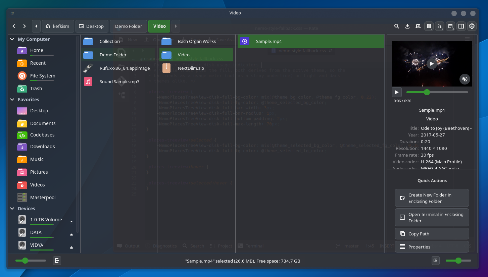

<div align="center">


# Dakkar

### Explore more. Lose your way less.

**A Miller Columns-focused file manager for Linux, based on [Nemo](https://github.com/linuxmint/nemo).**

Explore entire folder hierarchies at a glance, preview files in place, and make your workspace truly yours. Dakkar brings a fresh way to navigate files, backed by Nemo's familiar Linux file-management foundation.



**[Features](#features)** · **[Nemo compatibility](#nemo-compatibility)** · **[Releases](#releases)** · **[Build from source](#build-from-source)**

</div>

---

## See the whole picture

Dakkar is built around **Miller Columns**: instead of losing your place as you open folders, each level appears beside the last. The hierarchy grows as you explore, **without a fixed column limit**. Scroll horizontally, jump between levels, and always know where you are.

But navigation is only the beginning. Dakkar combines customizable visuals, powerful file tools, useful previews, and a Nemo-compatible workflow in one native desktop app.

## Features

### 🗂️ 01 — Miller Columns, first
**Unlimited, side-by-side folder navigation** with resizable columns, horizontal scrolling, drag-hover navigation, and an integrated details pane. Switch to familiar icon, list, or compact views whenever you like.

### 🛡️ 02 — Built-in copy integrity protection
**Checksum verification after copying**, enabled by default, helps detect accidental corruption. Choose SHA-1, SHA-256, or MD5, and see a clear failure instead of a silent success when verification doesn't match.

### 📈 03 — File transfers with real feedback
See **per-file progress, speeds, verification results, and completion summaries**. Pause, resume, skip, retry failed copies, or inspect transfer logs and optional history.

### ⚡ 04 — Quick Actions
Keep relevant tools close to your selection. **Pin, reorder, and customize actions**, switch between automatic, manual, and hybrid modes, or add your own commands and scripts.

### 🎨 05 — Make it yours
Fine-tune **colors, accents, transparency, corner rounding, toolbar layout, sidebar appearance, and icons**. Customize individual folder icons, file-type icons, and the details workspace—without redesigning your entire desktop.

### 👁️ 06 — Preview without opening
Use **Quick Look with Space**, inspect file metadata, preview images and text, and enjoy inline audio/video playback and album artwork where supported.

### 📦 07 — Smarter archives
**Compress and extract** common archive formats with progress reporting, integrity checks where supported, and safer handling of incomplete archives and extraction paths.

### 🔎 08 — Find and organize faster
Search names and supported file contents, use filters and regex, **group files by useful properties**, and keep organization choices independent across tabs.

---

## Nemo compatibility

**Dakkar is based on Nemo—and keeps its ecosystem close.**

- **Nemo Actions:** Supports `.nemo_action` definitions and importing them into Quick Actions.
- **Nemo Scripts:** Supports executable scripts, including importing them as custom actions.
- **Nemo Extensions:** Retains the Nemo extension API foundation; compatible native extensions may need to be rebuilt or installed in Dakkar's own extension location.

Existing actions and scripts can be copied or imported from Nemo's folders.

## Releases

Find available downloads and installation options on **[GitHub Releases](https://github.com/Kefkism/Dakkar/releases)**.

## Build from source

Dakkar is written in **C with GTK 3** and built using **Meson + Ninja**. You'll need the development dependencies for GTK 3, GLib/GIO, Cinnamon Desktop, XApp, GStreamer, and related libraries for your distribution.

Clone the repository:

```bash
git clone https://github.com/Kefkism/Dakkar.git
cd Dakkar
```

### Build locally

```bash
meson setup build --buildtype=release \
  --prefix="$HOME/.local/opt/dakkar" \
  --libdir=lib \
  -Dgtk_doc=false -Dtracker=false
meson compile -C build
```

### Install for your user

The included installer builds Dakkar, installs it in your home directory, and sets up its launcher and icons **without replacing Nemo**:

```bash
./packaging/sh/install.sh
```

Launch it:

```bash
~/.local/bin/dakkar
```

Uninstall:

```bash
./packaging/sh/uninstall.sh
```

The installer compiles from source, so build dependencies must be available. Additional packaging and build notes are in [`packaging/README.md`](packaging/README.md).

---

## Credits & acknowledgments

Dakkar builds on the work of the open-source community, with special thanks to:

- **[Nemo](https://github.com/linuxmint/nemo)** — Linux Mint and Nemo contributors, for the file manager Dakkar is based on and its core functionality and extensibility.
- **[Nemo Miller Columns](https://github.com/davemin/linux-nemo-miller-columns)** — Davide Minardi, for the Miller Columns work and inspiration that helped shape Dakkar's navigation focus.
- **[GNOME Files / Nautilus](https://gitlab.gnome.org/GNOME/nautilus)** — for the earlier foundation from which Nemo originated.

Upstream copyright notices and licensing information are preserved. These acknowledgments do not imply endorsement by the upstream projects.

## Contributing

Bug reports, ideas, and contributions are welcome. Please include your Linux distribution, desktop environment, and steps to reproduce issues when opening a report.

**[Open an issue](https://github.com/Kefkism/Dakkar/issues)** · **[Browse the source](src/)**

## License

Dakkar is open-source software licensed under **GPL-2.0-or-later**, with inherited components retaining their respective licenses. See [COPYING](COPYING), [NOTICE](NOTICE), and the other included license files.
